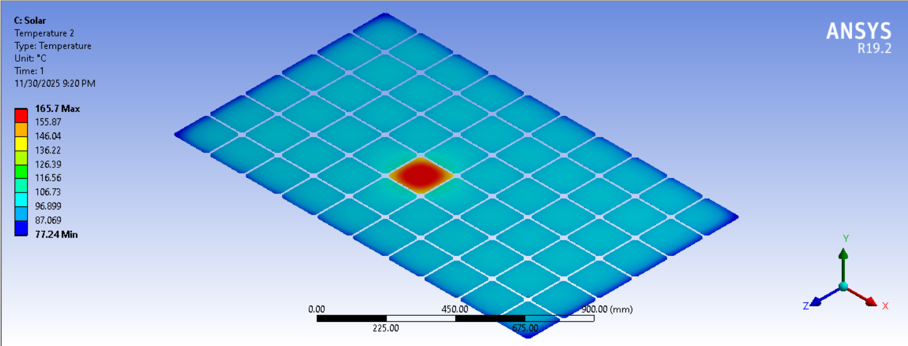
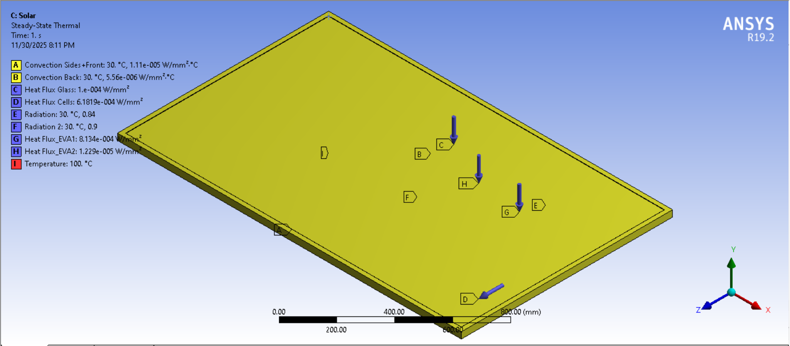
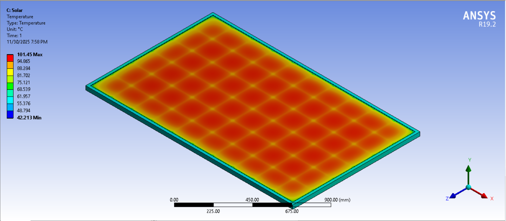
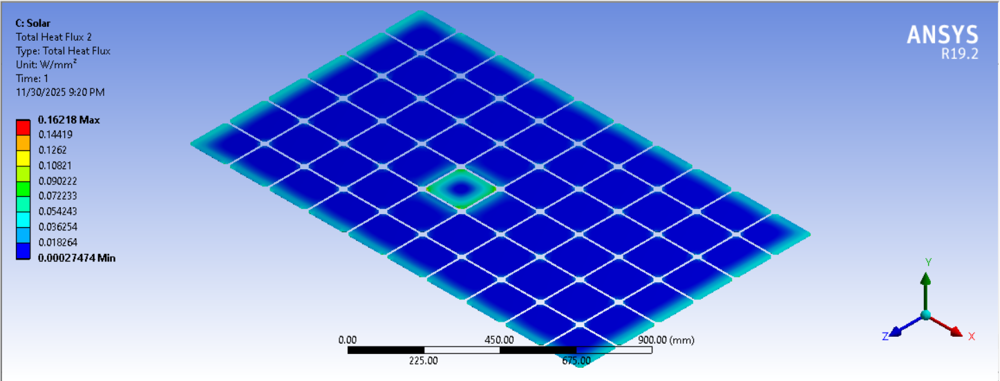

# Thermal Analysis of a PV Module with a Hot-Spot Cell Failure

**Author:** Aghyad ALI

Steady-state finite-element study (ANSYS Mechanical 19.2) of how a single failed cell
affects the temperature field of a 60-cell crystalline-silicon photovoltaic module.



## Why this matters
When one cell in a string is shaded, cracked or mismatched, it can be driven into reverse
bias and dissipate the power of its neighbours as heat. The resulting **hot spot** speeds up
EVA browning, back-sheet delamination and glass breakage, and is one of the most common
field failure modes found by IR inspection. This project quantifies how large that hot spot
gets and how far its heat spreads into neighbouring cells.

## Model
| Item | Value |
|---|---|
| Module | 1.68 m × 1.032 m × 31 mm, 6 × 10 cells of 156 × 156 mm |
| Layer stack (front to back) | Glass 3.2 mm / EVA 0.5 mm / Si cell 0.3 mm / EVA 0.5 mm / Tedlar 0.5 mm, aluminium frame |
| Contacts | Bonded, perfect thermal contact between layers |
| Mesh | MultiZone hex mesh on cells, 7 mm edge sizing; ~1.06 M nodes, 173 k elements; min orthogonal quality 0.72 |
| Analysis | Steady-state thermal, MAPDL solver |

**Materials**

| Layer | k [W/m·K] | ρ [kg/m³] | cp [J/kg·K] |
|---|---|---|---|
| Glass | 1.8 | 3000 | 500 |
| EVA | 0.35 | 960 | 2090 |
| Silicon | 148 | 2330 | 677 |
| Tedlar | 0.2 | 1200 | 1250 |
| Aluminium | 144 (at 0 °C) | 2770 | 875 |

**Boundary conditions**
- Ambient 30 °C
- Convection: front + sides h = 11.1 W/m²K, back h = 5.56 W/m²K
- Radiation to ambient: ε = 0.84 (front), 0.90 (back)
- Absorbed solar heat applied as surface heat flux on glass, EVA and cells
- **Failure case:** internal heat generation of 3.09 × 10⁶ W/m³ in one cell
  (≈ 22.6 W, equivalent to a reverse bias of ≈ 2.5 V at I_sc ≈ 9 A)



## Results
| Case | Cell temperature | Notes |
|---|---|---|
| Healthy module | max ≈ 101 °C, frame ≈ 42 °C | Cells hottest at their centres, cooler near the frame |
| One failed cell | **max ≈ 166 °C** at the faulty cell, neighbours ≈ 90–105 °C | ≈ 65 K above the healthy cell temperature |




Key observations
- The heat stays mostly inside the faulty cell. EVA (k = 0.35) and the 2 mm gaps between
  cells limit lateral conduction, so neighbours warm only a few kelvin.
- Heat flux concentrates on the faulty cell's edges, which are where thermal stress and
  EVA degradation would start.
- 166 °C is above the ~150 °C at which EVA starts to degrade and back sheets can blister,
  so a failure of this size would damage the module.

## Verification: hand calculation
`analysis/hand_calc.py` is a 1D thermal-resistance model of the same layer stack and
boundary conditions, used to sanity-check the FE result.

```
python analysis/hand_calc.py
```

| Quantity | Hand calc | FE |
|---|---|---|
| Healthy cell, realistic heat load (730 W/m²), with radiation | 56 °C | — |
| Healthy cell, flux as applied in FE (1544 W/m²), no radiation | 126 °C | 101 °C |
| Hot-spot rise above healthy cell | 24–33 K | ≈ 65 K |

## Limitations and next steps
- **Heat load:** the surface fluxes applied to glass, EVA and cells add up to ≈ 1544 W/m²,
  more than the 1000 W/m² incident irradiance. Absorbed heat should be ≈ 700–800 W/m²
  (irradiance × absorptance − electrical output). This is why the healthy module runs at
  ~100 °C, where real modules at STC-like conditions run at ~45–65 °C.
- **Mesh independence** has not been checked yet.
- **Steady state only.** A transient run would show how quickly a hot spot develops.
- **Next:** parametric sweep of the dissipated power (5–40 W), and a coupled
  thermal-structural run for the stress in the glass and solder joints.

## Repository layout
```
analysis/hand_calc.py   1D analytical cross-check
figures/                Exported result images
ansys/                  Workbench project: open ansys/Solar_PV.wbpj in ANSYS 19.2+ and re-solve
                        (solver result files are not tracked because of their size)
```

## How to run
```
pip install -r requirements.txt
python analysis/hand_calc.py
```

## Tools
ANSYS Workbench / Mechanical 19.2 (DesignModeler, Steady-State Thermal), Python (NumPy).

## License
MIT, see [LICENSE](LICENSE). © 2025 Aghyad ALI
